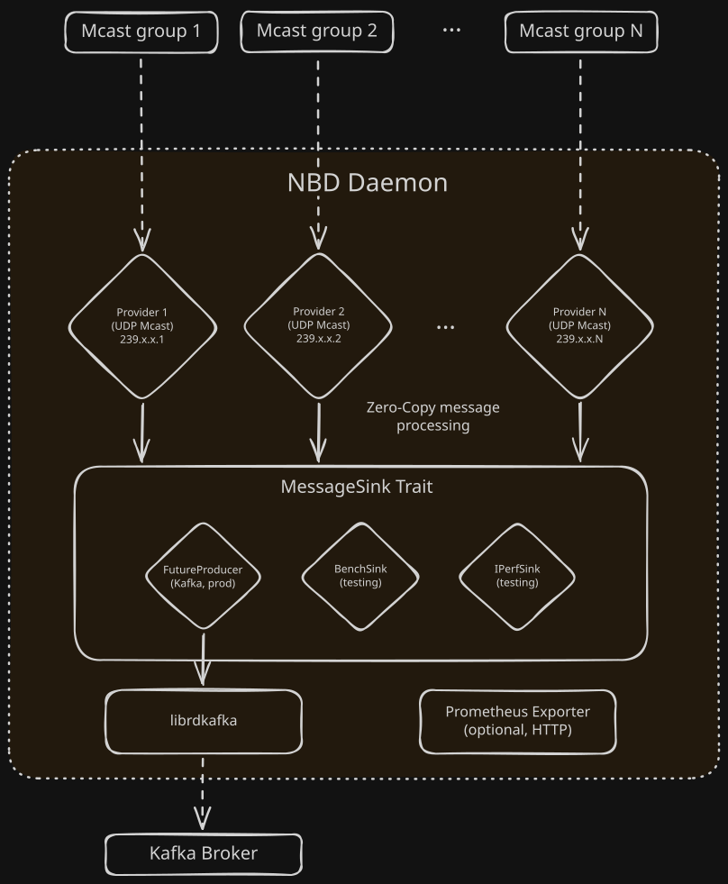

# Nothing But Data

<div align="center">
    
    <h3 align="center">Nothing But Data</h3>
    <p align="center">The No-Bullshit Daemon.</p>
    <div>
        <a href="https://github.com/PetitPrinc3/nbd/actions/workflows/build.yml/"></a>
        <a href="https://github.com/PetitPrinc3/nbd/actions/workflows/audit.yml/"></a>
        <br>
        
    </div>
</div>

---

**Nothing But Data** (NBD) is a lightweight, high-performance and secure data pipeline written in Rust, designed to ingest real-time UDP multicast traffic and efficiently relay it to an Apache Kafka broker.

It relies on multi-threading and zero-copy principles to provide a fully optimized system suited for sensitive production environments, delivering **sub-millisecond latency**.

It complies with the [ANSSI requirements](https://anssi-fr.github.io/rust-guide/) regarding Rust application development.

> [!IMPORTANT]
> While this project was written by a human and not vibe-coded, its documentation was generated by Claude Opus 4.6 (Thinking), Sonnet 5 and Sonnet 5.5.

## Table of Contents

- [Features](#features)
- [Architecture](#architecture)
  - [Kafka Producer Resilience](#kafka-producer-resilience)
- [Getting Started](#getting-started)
  - [Prerequisites](#prerequisites)
  - [Build](#build)
  - [Usage](#usage)
- [Configuration](#configuration)
  - [Example](#example)
  - [Validation rules](#validation-rules)
  - [\[nbd\] Section](#nbd-section)
  - [\[kafka\] Section](#kafka-section)
  - [\[kafka.tls\] Section](#kafkatls-section)
  - [\[kafka.auth\] Section](#kafkaauth-section)
  - [Secret Sources](#secret-sources)
  - [\[\[provider\]\] Section](#provider-section)
  - [\[metrics\] Section](#metrics-section)
- [Deployment](#deployment)
  - [System](#system)
  - [Systemd Service](#systemd-service)
  - [Kernel Tuning](#kernel-tuning)
- [Testing & Benchmarks](#testing--benchmarks)
- [Prometheus Metrics](#prometheus-metrics)
- [CI/CD](#cicd)
  - [Build](#build-buildyml)
  - [Audit](#audit-audityml)
  - [Release](#release-releaseyml)
  - [Supply Chain Security](#supply-chain-security-denytoml)
- [ANSSI Compliance](#anssi-compliance)
- [Project Structure](#project-structure)
- [Contributing](#contributing)
- [Changelog](#changelog)
- [License](#license)

## Features

- **High-performance data pipeline** from multiple UDP multicast groups to a single Kafka broker
- **Zero-copy buffer management** using `bytes::BytesMut` split-and-freeze pattern
- **Non-blocking ingestion & sink backpressure** with asynchronous delivery confirmation
- **Comprehensive configuration validation** with two-stage parse-then-validate approach
- **Graceful shutdown** via `CancellationToken` with in-flight message draining
- **Self-healing Kafka producer** — a supervisor rebuilds the Kafka client after a fatal error, without restarting the daemon, and refuses to rebuild it with a configuration that weakens TLS or SASL (see [Kafka Producer Resilience](#kafka-producer-resilience))
- **Optional Prometheus metrics exporter** over HTTP (feature-gated)
- **Optional TLS** for the Kafka connection (`kafka-tls` feature)
- **Optional SASL authentication** — credentials (PLAIN/SCRAM), Kerberos GSSAPI (`kafka-auth-gssapi`), OAuth 2.0/OIDC (`kafka-auth-oauth`)
- **Secure secret management** via `SecretSource`: literal, environment variable, or file — with Unix permission enforcement, and explicit erasure of the secrets once they have been used
- **Hardened code base** — `unsafe` is forbidden, and `clippy` denies `unwrap`/`expect`/`panic!`, unchecked arithmetic and unchecked indexing in the library and the daemon (see [ANSSI Compliance](#anssi-compliance))
- **Cross-platform** support (Linux & Windows, Tier 1 targets)
- **ANSSI-compliant** development practices (see [compliance matrix](#anssi-compliance))

## Architecture



*In production, the sink drawn as `FutureProducer` is wrapped in a `ManagedProducer`, see [below](#kafka-producer-resilience).*

Each **Provider** is an async Tokio task that:
1. Creates and configures an OS-level multicast socket via `socket2` (IGMP/MLD join, buffer sizing, non-blocking I/O)
2. Receives UDP datagrams into a `BytesMut` buffer
3. Splits received bytes via `split_to().freeze()` producing reference-counted `Bytes` — **zero memory copy**
4. Submits payloads non-blockingly to a `MessageSink` implementation (`sink.submit()`), managing in-flight delivery confirmations asynchronously without stalling UDP reception
5. Drains all in-flight messages before terminating on cancellation

In production, the sink shared by all providers is a `ManagedProducer`: a handle on the Kafka producer that a supervisor task can replace when the producer fails. The in-memory sinks (`BenchSink`, `IPerfSink`) only serve the tests and benchmarks.

### Kafka Producer Resilience

A `librdkafka` producer that raises a *fatal* error cannot be used anymore. Rather than leaving the daemon with a dead Kafka connection until someone restarts it, NBD supervises the producer and rebuilds it:

1. The supervisor checks the producer every 500 ms, and immediately when a submission reports a fatal error.
2. It builds a new producer, using the `[kafka]` section of the configuration file as it is at that moment, then swaps it in. Providers keep using the same handle and transparently pick up the new producer. A configuration that weakens the security of the connection compared with the running one is refused instead (see below).
3. If a fatal error comes back shortly after a recreation, or if the rebuild itself fails, the attempts are spaced out with an exponential back-off (1 s, 2 s, 4 s, ... capped at 60 s).
4. If the rebuild keeps failing for [`recovery_timeout`](#kafka-section) (10 minutes by default), NBD gives up, stops gracefully and **exits with an error**. Under the [systemd unit](#systemd-service) below, `Restart=on-failure` then restarts it.

What to expect:

- **Datagrams are lost while the producer is faulted.** Submissions are rejected until the new producer is installed, and a UDP multicast feed cannot be replayed. With the `metrics-exporter` feature, they are counted in `nbd_errors_sender_total`. Messages already in flight on the faulted producer may not be delivered either.
- **Only fatal errors trigger a recreation.** A broker that is slow or unreachable does not: `librdkafka` reconnects by itself, and the failures show up as delivery errors (`nbd_errors_kafka_transmission_total`). `librdkafka` raises fatal errors for idempotent producers, which is the default (`idempotence = true`, `acks = "all"`). With idempotence disabled, there is little for the supervisor to detect.
- **A failed rebuild is not a broker outage.** Building a producer does not wait for the broker, so `recovery_timeout` is consumed by failures of the rebuild itself: unreadable or invalid configuration file, unresolvable secrets, a configuration refused for weakening the connection, TLS/SASL material rejected by `librdkafka`. Unlike at startup, the broker is not probed after a recreation.
- **The configuration file is read again at runtime, and a downgrade is refused.** Besides the file itself, every file it references (TLS certificates and keys, keytab, secret files) must stay readable for the whole life of the daemon, and must be protected against modification: an edit of the `[kafka]` section is applied at the next recreation. The one safeguard is a comparison of the *security posture* (broker, paths of the TLS files, SASL mechanism) of the new configuration with the running one. These changes are **refused**: removing `[kafka.tls]`, changing `ca_file`, removing `cert_file`/`key_file`, removing `[kafka.auth]`, or switching to a weaker SASL mechanism (from strongest to weakest: `GSSAPI` and `OAUTHBEARER`, `SCRAM-SHA-512`, `SCRAM-SHA-256`, `PLAIN`). A change of `broker` is only reported with a warning, and neither the content of the TLS files nor the credentials are compared. A refusal is logged as an error and counts as a failed rebuild: NBD retries, so restoring the file is enough, and otherwise exits after `recovery_timeout`. Restarting NBD applies the new configuration, since a startup trusts the file. See [SECURITY.md](SECURITY.md#kafka-producer-recovery).
- **A replaced producer is retired before the supervisor resumes.** It waits for the listeners to release it (5 s at most), then for its destruction (5 s at most). A new fatal error right after a recreation can therefore take up to about 10 s to be noticed.
- **Monitor it.** With the `metrics-exporter` feature, `nbd_errors_kafka_fatal_total`, `nbd_kafka_recreation_total` and `nbd_kafka_producer_generation` track the recoveries (see [Prometheus Metrics](#prometheus-metrics)).

On shutdown, NBD stops the listeners, stops the supervisor, then closes the producer: it waits for the last listener to release it and for its destruction. Each step is bounded by 5 seconds (the closing of the producer has two such steps).

## Getting Started

### Prerequisites

| Dependency | Purpose |
|---|---|
| **Rust 1.99.1+** | Pinned via `rust-toolchain.toml` |
| **C/C++ toolchain** and **CMake** | Required to build `librdkafka` through `rdkafka` (`cmake-build` feature). The `kafka-auth-gssapi` and `kafka-auth-oauth` features also need `libsasl2-dev` and `libcurl4-openssl-dev` (Debian/Ubuntu), see [CONTRIBUTING.md](CONTRIBUTING.md#development-environment-setup) |
| **Apache Kafka broker** | Target message broker |

### Build

```bash
# Standard build
cargo build --release

# With Prometheus metrics exporter
cargo build --release --features metrics-exporter

# With TLS support for Kafka
cargo build --release --features kafka-tls

# With Kerberos GSSAPI authentication
cargo build --release --features kafka-auth-gssapi

# With OAuth 2.0 / OIDC authentication
cargo build --release --features kafka-auth-oauth

# All features enabled
cargo build --release --features metrics-exporter,kafka-tls,kafka-auth-gssapi,kafka-auth-oauth
```

> [!IMPORTANT]
> A build without `kafka-tls` talks to Kafka in plaintext, and the binaries attached to the GitHub Releases are built this way (see [Release](#release-releaseyml)). To encrypt or authenticate the connection, build from source with the features you need. A configuration that has a `[kafka.tls]` section is refused by a binary that was built without `kafka-tls`.

### Usage

```bash
# Run the daemon with a configuration file
nbd --config-file /path/to/config.toml

# Validate a configuration file (dry-run)
nbd --check-config-file /path/to/config.toml

# Display build & version information
nbd --about
```

| Flag                         | Description                                                                                       | Conflicts with        |
| ---------------------------- | ------------------------------------------------------------------------------------------------- | --------------------- |
| `--config-file <PATH>`       | Path to the TOML configuration file. Without it, NBD logs an error and uses `./config.toml`        | `--check-config-file` |
| `--check-config-file <PATH>` | Validate configuration without running                                                            | `--about`             |
| `--about`                    | Show version (with enabled features), build date, architecture, authors                           | `--config-file`       |
| `-V`, `--version`            | Print the version, followed by the enabled features, e.g. `0.2.0-beta [+kafka-tls]`               |                       |
| `-h`, `--help`               | Print the usage                                                                                   |                       |

`--check-config-file` runs the same permission checks and validation as a startup, then exits. It does not contact the broker, and it only fails on invalid TOML and on the errors listed in [Validation rules](#validation-rules): a value that is replaced by a default (an invalid topic, for example) is reported in the output, but doesn't make the check fail, so read the output rather than only the exit status. The log level is `info`, or the one set by the `RUST_LOG` environment variable.

## Configuration

NBD uses a TOML configuration file with a **two-stage validation** approach: raw deserialization into intermediate structs, then transformation into validated, strongly-typed runtime structs with sensible defaults and diagnostic logging.

### Example

```toml
[nbd]
socket_buffer_size = 200000
verbosity = "info"

[kafka]
broker = "192.168.1.100:9092"
connection_timeout = 5000
recovery_timeout = 600000
message_timeout = 6000
message_retries = 2

[metrics]
interface = "192.168.1.200"
port = 9000

[[provider]]
topic = "market-data-feed"
group = "239.255.0.1"
port = 20001
message_size = 1500
interface = "192.168.1.200"

[[provider]]
topic = "order-events"
group = "239.255.0.2"
port = 20002
message_size = 2048
interface = "192.168.2.200"
```

### Validation rules

- **Defaults and replacements.** A missing parameter takes its default value, and most invalid values are replaced by one (for example an invalid `topic` becomes `nbd-connector`, and `message_retries = 0` becomes `2`). Each case is reported in the logs, at `warn` or `error` level: the daemon starts anyway, so check the output of `--check-config-file` before deploying.
- **Errors.** The daemon refuses to start on a missing `[kafka]` section or `broker`, on a file without any `[[provider]]` section, on a `group` that is not a multicast address, on `socket_buffer_size = 0`, on an empty or unresolvable secret, on a missing TLS or Kerberos file, on an unreadable secret, and on secret files whose permissions are too open (see [Secret Sources](#secret-sources)).
- **Unknown keys.** `[kafka]` and all its sub-sections reject unknown keys, so a typo there is an error. `[nbd]`, `[metrics]`, `[[provider]]` and the top level of the file **ignore** them: a misspelled key in those sections is silently replaced by its default value, so double-check the names.
- **Log level.** `verbosity` sets the log level once the file is parsed, until then the level is `info`. The `RUST_LOG` environment variable, when set, takes precedence over both.

### `[nbd]` Section

General daemon configuration.

| Parameter | Type | Default | Description |
|---|---|---|---|
| `socket_buffer_size` | `usize` | `204800` (200 KB) | OS receive buffer size (bytes) per socket. Values < 100 KB are reported in the logs, since packets are dropped once the buffer is full. `0` is refused. |
| `verbosity` | `string` | `"info"` | Log level: `trace`, `debug`, `info`, `warn`, `error`. `debug` and `trace` log a line for each delivered message, which is not meant for production. Can be overridden by `RUST_LOG`. |

### `[kafka]` Section

Apache Kafka producer configuration.

| Parameter            | Type     | Default      | Description                                                                                                       |
| -------------------- | -------- | ------------ | ----------------------------------------------------------------------------------------------------------------- |
| `broker`             | `string` | **required** | Kafka broker address as `<ip>:<port>` or `<hostname>:<port>`. The address is resolved when the file is validated: a failure is logged, but doesn't stop the daemon, the connectivity check made at startup is what fails on an unreachable broker. |
| `connection_timeout` | `u64`    | `2000`       | Timeout in ms of the connectivity check made at startup, before any traffic is accepted. It is not applied to the producer itself. Values < 500 ms trigger a warning. |
| `recovery_timeout`   | `u64`    | `600000`     | Maximum time (ms) NBD keeps failing to rebuild a faulted Kafka producer before exiting with an error (see [Kafka Producer Resilience](#kafka-producer-resilience)). `0` is replaced by the default. Values < 10 000 ms trigger a warning: NBD exits quickly if the rebuild keeps failing. |
| `message_timeout`    | `u64`    | `100`        | Per-message delivery timeout in ms (`message.timeout.ms`). Values < 10 ms trigger a warning.                       |
| `message_retries`    | `u16`    | `2`          | Number of delivery retries (`message.send.max.retries`). `0` is replaced by the default.                           |
| `compression`        | `string` | `"lz4"`      | Compression codec: `none`, `lz4`, `gzip`, `snappy`, `zstd`.                                                      |
| `idempotence`        | `bool`   | `true`       | Enable idempotent producer. Automatically disabled if `acks` ≠ `all`/`-1`. Producer self-recovery relies on the fatal errors `librdkafka` raises for idempotent producers. |
| `linger`             | `u16`    | `1`          | Batching delay in ms (`linger.ms`).                                                                               |
| `acks`               | `string` | `"all"`      | Broker acknowledgement level: `all`, `-1`, `1`, `0`.                                                             |
| `queue_size`         | `u32`    | `100000`     | Maximum number of messages in the producer queue (`queue.buffering.max.messages`).                                 |
| `parallel_requests`  | `u16`    | `5`          | Max in-flight requests per connection. Capped at 5 when `idempotence = true`.                                     |

### `[kafka.tls]` Section

*Requires the `kafka-tls` feature.* Enables TLS-encrypted communication with the Kafka broker. The `security.protocol` is automatically set to `ssl` (or `sasl_ssl` when auth is also configured).

```toml
[kafka.tls]
ca_file      = "/etc/nbd/tls/ca.pem"
cert_file    = "/etc/nbd/tls/client.pem"                    # optional (mutual TLS)
key_file     = "/etc/nbd/tls/client.key"                    # optional (mutual TLS)
key_password = { file = "/run/secrets/tls_key_password" }   # optional
```

| Parameter      | Type           | Default      | Description                                                                 |
| -------------- | -------------- | ------------ | --------------------------------------------------------------------------- |
| `ca_file`      | `string`       | **required** | Path to the CA certificate file (PEM). File must exist.                     |
| `cert_file`    | `string`       | optional     | Path to the client certificate file (PEM). Must be paired with `key_file`.  |
| `key_file`     | `string`       | optional     | Path to the client private key file (PEM). Must be paired with `cert_file`. |
| `key_password` | `SecretSource` | optional     | Password for the private key. Accepts a [secret source](#secret-sources).   |

These files are read again every time the producer is rebuilt, and the paths of the CA, certificate and key are part of the *security posture* that a rebuild is not allowed to weaken (see [Kafka Producer Resilience](#kafka-producer-resilience)).

### `[kafka.auth]` Section

Enables SASL authentication. Three mutually exclusive sub-schemas are supported. The `security.protocol` (`sasl_plaintext` or `sasl_ssl`) is automatically derived from the combination of `tls` and `auth` presence. Without `[kafka.tls]`, the credentials travel unencrypted, and NBD warns about it at startup. The secrets of these sections are given as [secret sources](#secret-sources).

#### Credentials (PLAIN / SCRAM)

`PLAIN` is always available. The `SCRAM-SHA-256` and `SCRAM-SHA-512` mechanisms require the `kafka-tls` feature.

```toml
[kafka.auth]
username  = { env = "KAFKA_USER" }
password  = { file = "/run/secrets/kafka_password" }
mechanism = "PLAIN"   # or "SCRAM-SHA-256" / "SCRAM-SHA-512" (requires kafka-tls)
```

| Parameter   | Type           | Default      | Description                                                |
| ----------- | -------------- | ------------ | ---------------------------------------------------------- |
| `username`  | `SecretSource` | **required** | Kafka SASL username.                                       |
| `password`  | `SecretSource` | **required** | Kafka SASL password.                                       |
| `mechanism` | `string`       | `"PLAIN"`    | SASL mechanism: `PLAIN`, `SCRAM-SHA-256`, `SCRAM-SHA-512`. Not setting it is reported with a warning, since `PLAIN` is the weakest. |

#### Kerberos GSSAPI

*Requires the `kafka-auth-gssapi` feature.*

```toml
[kafka.auth.gssapi]
principal    = "nbd@EXAMPLE.COM"
keytab       = "/etc/nbd/nbd.keytab"
service_name = "kafka"
```

| Parameter      | Type     | Default      | Description                                                                                                                           |
| -------------- | -------- | ------------ | ------------------------------------------------------------------------------------------------------------------------------------- |
| `principal`    | `string` | **required** | Kerberos principal NBD authenticates as, in `<name>@<REALM>` form (`sasl.kerberos.principal`).                                        |
| `keytab`       | `string` | **required** | Path to the keytab file holding the principal's credentials, used to obtain and renew tickets (`sasl.kerberos.keytab`). The file must exist, and its permissions are checked like those of a secret file. |
| `service_name` | `string` | **required** | Kerberos service name of the Kafka brokers. Must match the brokers' own service name, usually `kafka` (`sasl.kerberos.service.name`). |

#### OAuth 2.0 / OIDC

*Requires the `kafka-auth-oauth` feature.*

```toml
[kafka.auth.oauth]
token_endpoint_url = "https://auth.example.com/oauth/token"
client_id          = "nbd-client"
client_secret      = { env = "KAFKA_OAUTH_SECRET" }
scope              = "kafka"   # optional
extensions         = ""        # optional
```

| Parameter            | Type           | Default      | Description                                                                                                                                               |
| -------------------- | -------------- | ------------ | --------------------------------------------------------------------------------------------------------------------------------------------------------- |
| `token_endpoint_url` | `string`       | **required** | URL of the identity provider's token endpoint, queried with the client credentials grant to obtain access tokens (`sasl.oauthbearer.token.endpoint.url`). A URL that is not `https://` triggers a warning. |
| `client_id`          | `string`       | **required** | Client identifier registered for NBD with the identity provider (`sasl.oauthbearer.client.id`). Cannot be empty.                                          |
| `client_secret`      | `SecretSource` | **required** | Client secret associated with `client_id`. Accepts a [secret source](#secret-sources) (`sasl.oauthbearer.client.secret`).                                 |
| `scope`              | `string`       | `none`       | Scope requested in the token request, e.g. `kafka` (`sasl.oauthbearer.scope`).                                                                            |
| `extensions`         | `string`       | `none`       | Additional SASL/OAUTHBEARER extensions sent to the broker, as comma-separated `key=value` pairs (`sasl.oauthbearer.extensions`).                          |

### Secret Sources

Wherever a `SecretSource` is accepted (`username`, `password`, `key_password`, `client_secret`), the value can be supplied in one of three forms:

```toml
# Inline literal (config file must be chmod 600 on Unix)
password = "my-secret"

# From a shell environment variable
password = { env = "MY_SECRET_VAR" }

# From a file (file must be chmod 600 on Unix)
password = { file = "/run/secrets/my_secret" }
```

> [!WARNING]
> On Unix, NBD verifies that files containing secrets have permissions `600` (owner read/write only) and refuses to start if group- or world-readable bits are set. The check covers the configuration file when a `password`, `key_password` or `client_secret` is an inline literal, the files of `{ file = "..." }` sources for those three, the TLS `key_file` and the Kerberos `keytab`. It runs at startup and again each time the producer is rebuilt. A `username` source and the public files (`ca_file`, `cert_file`) are not checked, and on Windows the check only emits a warning.

Secrets are erased from NBD's memory once they have been used (see [SECURITY.md](SECURITY.md#configuration-and-secrets-handling) for what that does and does not cover). Prefer `{ env }` and `{ file }` over inline literals: a TOML syntax error is logged with the offending line of the file, which may be the one holding the secret.

### `[[provider]]` Section

Repeatable section — one per multicast stream to ingest. At least one is required.

| Parameter      | Type                         | Default                         | Description                                                                                        |
| -------------- | ---------------------------- | ------------------------------- | -------------------------------------------------------------------------------------------------- |
| `topic`        | `string`                     | `"nbd-connector"`               | Kafka topic name, 1–254 chars, `[a-zA-Z0-9._-]` only. A missing or invalid name is **replaced by `nbd-connector`** (with an error in the logs): the data goes to that topic rather than the daemon failing. |
| `group`        | `IpAddr`                     | **required**                    | Multicast group IP (must be a valid multicast address).                                            |
| `port`         | `u16`                        | `20000 + index`                 | UDP port. `0` is replaced by the default. Warns if < 1024 (well-known) or > 49151 (ephemeral).     |
| `message_size` | `usize`                      | `min(1500, socket_buffer_size)` | Expected max datagram size. `0` is replaced by the default, and values > 65,507 (UDP max) are capped to 65,507, which bounds the receive buffer allocated per provider (100 times this value). Warns if > `socket_buffer_size` (the value is kept). |
| `interface`    | `Ipv4Addr` or `u32` for Ipv6 | `0.0.0.0` / `0`                 | Network interface to bind. IPv4 address or IPv6 interface index. Must match the group's IP family (otherwise the default is used, with a warning). |

### `[metrics]` Section

*Requires the `metrics-exporter` feature.*

| Parameter   | Type     | Default     | Description                                                 |
| ----------- | -------- | ----------- | ----------------------------------------------------------- |
| `interface` | `IpAddr` | `127.0.0.1` | HTTP listener interface. An address that doesn't belong to the host is replaced by `127.0.0.1`, with a warning. |
| `port`      | `u16`    | `9000`      | HTTP listener port for Prometheus scraping.                 |

## Deployment

### System

For deployment in sensitive production environments, the host operating system should be configured in accordance with your organization's security and networking baselines:

- **CIS Benchmark Compatibility**: Nothing But Data is fully compatible with a **CIS Level 2 – Server** profile on Debian/Ubuntu hosts. The daemon requires no root privileges, drops all Linux kernel capabilities, and operates cleanly under restricted system policies.
- **Firewall & Routing Requirements**:
  - **Multicast Ingress**: Ensure multicast routing and IGMP snooping are active on the network interface, and allow inbound UDP traffic on configured provider ports (e.g. `20000+`).
  - **Kafka Egress**: Allow outbound TCP traffic to the target Kafka broker endpoint (default `9092` or TLS `9094`).
  - **Metrics Ingress** *(optional)*: Allow inbound HTTP traffic on the Prometheus exporter port (default `9000`), preferably restricted to trusted monitoring subnets or loopback.

### Systemd Service

A production-ready, security-hardened systemd unit file is provided below :

```ini
[Unit]
Description=Nothing But Data
After=network-online.target

[Service]
ExecStart=/opt/nbd/nbd --config-file /opt/nbd/config.toml
Restart=on-failure
RestartSec=5

# Security hardening
DynamicUser=true
NoNewPrivileges=true
ProtectSystem=strict
ProtectHome=true
PrivateTmp=true
ReadOnlyPaths=/opt/nbd
CapabilityBoundingSet=
LimitNOFILE=65536

[Install]
WantedBy=multi-user.target
```

`Restart=on-failure` complements the in-process [Kafka producer recovery](#kafka-producer-resilience): NBD exits with an error when it cannot rebuild its producer within `kafka.recovery_timeout`, and systemd restarts it after `RestartSec`.

Key hardening features:
- **`DynamicUser=true`** — transient non-root user allocated per run
- **`CapabilityBoundingSet=`** — all kernel capabilities dropped
- **`ProtectSystem=strict`** — the whole file system hierarchy is mounted read-only, except `/dev`, `/proc` and `/sys`
- **`LimitNOFILE=65536`** — expanded file descriptor limit for high socket concurrency

> [!WARNING]
> **`DynamicUser=true` is incompatible with the [secret file permission checks](#secret-sources).** systemd runs the service under a transient UID that changes on every start, so no file can be owned by it in advance. Files containing secrets (a configuration file with inline literals, `{ file = "..." }` secret sources) must be `chmod 600`, i.e. readable by their owner only:
>
> - if they belong to another user (e.g. `root`), the dynamic user cannot read them;
> - if they are made group- or world-readable so that the dynamic user can read them, NBD refuses to start.
>
> To supply secrets to NBD, either:
>
> - replace `DynamicUser=true` with a dedicated static user (`User=nbd` / `Group=nbd`) and give it ownership of the secret files (`chown nbd:nbd` + `chmod 600`); or
> - keep `DynamicUser=true` and use `{ env = "..." }` secret sources, fed through `EnvironmentFile=` (a root-owned `chmod 600` file, read by systemd rather than by the service).

### Kernel Tuning

Under sustained or bursty multicast traffic, standard OS-level receive buffers can overflow, leading to silent packet drops before datagrams reach userspace.

In this case, it is recommended to increase the following kernel parameters :

```ini
# Increase maximum and default UDP receive buffer sizes
net.core.rmem_max = 16777216
net.core.rmem_default = 8388608

# Increase network device input backlog queue length
net.core.netdev_max_backlog = 10000
```

Apply these settings system-wide, by saving them in `/etc/sysctl.d/99-nbd-sysctl.conf` and reloading the configuration:

```bash
sudo tee /etc/sysctl.d/99-nbd-sysctl.conf <<'EOF'
net.core.rmem_max = 16777216
net.core.rmem_default = 8388608
net.core.netdev_max_backlog = 10000
EOF
sudo sysctl --system
```

`socket_buffer_size` can't exceed `net.core.rmem_max`: the kernel silently caps the buffer of a socket to that value.

## Testing & Benchmarks

NBD includes an integration test suite with performance benchmarks. The benchmarks use the library's `BenchSink` or `IPerfSink` (in-memory mock sinks) to validate the pipeline without requiring a Kafka broker. The `config` test checks the configuration validation and that secrets never leak through `Debug` output. There is no unit test (`cargo test --lib` runs none) and no automated test of the Kafka producer recovery.

```bash
# Check the configuration validation and the secret handling (also run on Windows in CI)
cargo test --test config

# Run a quick latency smoke test (3 packets)
cargo test --test simple_latency -- --nocapture

# Run a 5-minute sustained load test at 1 kHz
cargo test --test stress -- --nocapture

# Run a 10-second extreme burst test (1 µs interval)
cargo test --test spike -- --nocapture

# Run a 5-channel concurrent stress test
cargo test --test multi_channel_stress -- --nocapture

# Run with external iperf UDP streams (requires iperf running separately)
cargo test --test multi_channel_iperf_stress -- --nocapture
```

| Test | Duration | Channels | Frequency | Purpose |
|---|---|---|---|---|
| `config` | Instant | — | — | Configuration validity, secrets never leaked in `Debug` output |
| `simple_latency` | Instant | 1 | 3 packets | Baseline latency validation |
| `stress` | 5 min | 1 | 1 kHz | Sustained throughput |
| `spike` | 10 s | 1 | 1 MHz | Burst resilience, packet loss |
| `multi_channel_stress` | 5 min | 5 | 100 kHz/channel | Multi-stream concurrency |
| `multi_channel_iperf_stress` | 5 min | 5 | External | Real-world iperf validation |

The benchmarks produce standardized ASCII reports with **p50**, **p95**, **p99**, **p99.9**, and **max** latency distributions.  
A performance review is provided in [PERFORMANCE.md](PERFORMANCE.md).

> **Windows note**: Tests automatically call `NtSetTimerResolution` via FFI (inside the `tests/` crate only, not production code) to lower the OS timer granularity from 15.6 ms to ~0.5 ms for accurate sub-millisecond measurements.

## Prometheus Metrics

When built with `--features metrics-exporter`, NBD exposes the following counters and gauge via an HTTP endpoint:

| Metric                        | Type    | Labels  | Description                                             |
| ----------------------------- | ------- | ------- | ------------------------------------------------------- |
| `nbd_udp_packets_total`       | Counter | `group` | Total UDP packets received                              |
| `nbd_udp_bytes_total`         | Counter | `group` | Total UDP bytes received                                |
| `nbd_udp_empty_packets_total` | Counter | `group` | Empty/zero-length UDP packets received                  |
| `nbd_kafka_sent_total`        | Counter | `topic` | Messages successfully confirmed by Kafka broker         |
| `nbd_errors_listeners_total`  | Counter | `group` | Listener-level network receive errors                   |
| `nbd_errors_full_queue_total` | Counter | `group` | Datagrams dropped due to sink queue full (backpressure) |
| `nbd_errors_sender_total`     | Counter | `group` | Messages rejected upon submission to sink (including while the Kafka producer is faulted) |
| `nbd_errors_kafka_transmission_total` | Counter | `topic` | Kafka delivery failures during transaction confirmation (renamed from `nbd_errors_kafka_total`) |
| `nbd_errors_kafka_fatal_total` | Counter | — | Fatal errors raised by the Kafka producer                |
| `nbd_kafka_recreation_total`  | Counter | — | Successful Kafka producer recreations                   |
| `nbd_kafka_producer_generation` | Gauge | — | Generation of the current Kafka producer (`0` is the initial one, incremented at each recreation) |

The `group` label is the multicast group address of the provider, and `topic` the Kafka topic. The endpoint is plain HTTP and unauthenticated, see [SECURITY.md](SECURITY.md#metrics-endpoint-exposure).

The delivery failure warnings of the logs are limited to one per topic and per second. `nbd_errors_kafka_transmission_total` counts every failure.

## CI/CD

GitHub Actions pipelines enforce quality gates on every push and pull request to `main`. The release pipeline runs on version tags.

### Build (`build.yml`)

| Job | Steps |
|---|---|
| `build-linux` | `cargo fmt -- --check`, then `cargo build --release --all-features` |
| `build-windows` | `cargo test --test config`, then `cargo build --release --features metrics-exporter` |

### Audit (`audit.yml`)

- **`cargo fmt -- --check`** — enforced formatting
- **`cargo outdated --exit-code 1`** — fails as soon as a dependency is out of date
- **`cargo audit`** — known vulnerability scanning (RUSTSEC advisories)
- **`cargo check --all-features`** — full feature compilation
- **`cargo hack clippy --feature-powerset --all-targets -- -D warnings`** — zero-warning linting policy, on every combination of features. It includes the panic and overflow lints denied by the library and the daemon. The crates of `tests/` are linted too, but with the default lints only.
- **`cargo hack test --lib --feature-powerset`** — unit tests, on every combination of features. There is no unit test at the moment, so this step runs nothing.
- **`cargo deny check`** — license compliance, crate bans, source restrictions
- **`cargo build --release --all-features`** — final build verification

The Linux jobs install `libcurl4-openssl-dev` and `libsasl2-dev` so that the optional Kafka features can be built.

### Release (`release.yml`)

Triggered on every `v*` tag push (or manually via `workflow_dispatch`, with an optional `tag` input):

- Compiles Linux (`ubuntu-latest`) and Windows (`windows-latest`) binaries in parallel.
- Produces two artifacts per platform: standard build and `with_metrics` build (`--features metrics-exporter`).
- Attaches all four binaries to the corresponding GitHub Release automatically.

> [!WARNING]
> The released binaries are built **without** `kafka-tls` and `kafka-auth-*`: they connect to Kafka in `PLAINTEXT`, refuse a configuration that has a `[kafka.tls]` section, and only support the SASL `PLAIN` mechanism (sent unencrypted). Build from source with the relevant features for any deployment that crosses an untrusted link, see [Build](#build).

The release pipeline doesn't wait for, or re-run, the Build and Audit pipelines: tag a commit on which they passed.

### Supply Chain Security (`deny.toml`)

| Rule | Policy |
|---|---|
| Yanked crates | **Denied** |
| Unmaintained crates | **Denied** (`unmaintained = "all"`, direct and transitive) |
| Allowed licenses | MIT, Apache-2.0, BSD-3-Clause, Zlib, Unlicense, GPL-3.0-or-later, Unicode-3.0 |
| Allowed sources | `crates.io` only — no unknown registries or git sources |
| Native C build tools | `cc`, `cmake` and `pkg-config` are banned except as dependencies of vetted wrappers (`rdkafka-sys`, `libz-sys`, `openssl-sys`, `sasl2-sys`, `curl-sys`, ...). `bindgen` is banned outright. |
| Multiple versions | Warned |

## ANSSI Compliance

NBD tracks compliance against the [ANSSI Secure Rust Development Guide](https://anssi-fr.github.io/rust-guide/). The [compliance matrix](SECURITY.md#anssi-compliance-matrix) of `SECURITY.md` goes through the 60 rules of the guide with the evidence behind each status: 27 are fulfilled, 33 don't apply to NBD (mostly the `unsafe` and FFI families), none is partially fulfilled.

Key compliance highlights:

| Category | Measures | Status |
|---|---|---|
| **Unsafe code** | `#![forbid(unsafe_code)]` at the root of the library and of the daemon | ✅ |
| **Memory safety** | `#![deny(clippy::mem_forget)]`, no raw pointer casts | ✅ |
| **Integer overflow** | `overflow-checks = true` in release profile, `clippy::arithmetic_side_effects` denied | ✅ |
| **Error handling** | Centralized `NbdError` enum via `thiserror` (checked `Send + Sync + UnwindSafe`), `unwrap`/`expect`/`panic!` and unchecked indexing denied by `clippy` | ✅ |
| **Naming** | Getters without a `get_` prefix (`Provider::socket`) | ✅ |
| **Toolchain** | Pinned stable toolchain (1.99.1), Tier 1 targets only | ✅ |
| **Secrets in memory** | Explicit zeroization of secrets once used, on top of `Drop` | ✅ |
| **Dependencies** | `cargo-audit`, `cargo-outdated`, `cargo-deny` in CI | ✅ |
| **Formatting & linting** | `rustfmt` + `clippy -D warnings` enforced | ✅ |
| **FFI** | N/A (no C FFI exposed) | — |

The `clippy` lints are enforced by the CI (`cargo clippy`), not by a plain `cargo build`, and they don't apply to the integration tests of `tests/`. `SECURITY.md` details these limits, along with what the matrix doesn't measure (deployment, runtime behavior).

## Project Structure

```
nbd/
├── src/
│   ├── main.rs            # Entry point: CLI, logging, shutdown orchestration
│   ├── lib.rs             # Library root, public re-exports
│   ├── args.rs            # CLI argument definitions (clap derive)
│   ├── about.rs           # --about display with ASCII art & build info
│   ├── config.rs          # Two-stage TOML config parsing & validation, secret handling, security posture
│   ├── providers.rs       # UDP multicast socket setup & zero-copy recv loop
│   ├── sinks.rs           # MessageSink trait + Kafka/Bench/IPerf impls
│   ├── kafka.rs           # Kafka producer builder + self-healing ManagedProducer & supervisor
│   └── errors.rs          # NbdError enum (thiserror) + UnwindShield
├── tests/
│   ├── commons/mod.rs     # Test utilities: percentile stats, ASCII reports
│   ├── config.rs          # Configuration validity and secret-leak tests
│   ├── simple_latency.rs  # Smoke test (3 packets)
│   ├── stress.rs          # 5-min sustained load benchmark
│   ├── spike.rs           # 10-sec burst resilience test
│   ├── multi_channel_stress.rs       # 5-channel concurrent benchmark
│   └── multi_channel_iperf_stress.rs # External iperf validation
├── .github/workflows/
│   ├── build.yml          # Build CI pipeline
│   ├── audit.yml          # Security & quality audit pipeline
│   └── release.yml        # Binary compilation & GitHub Release publishing
├── images/                # Logo assets and architecture diagram
├── build.rs               # Injects the build date, architecture, features and full version at compile time
├── Cargo.toml             # Project manifest & dependencies
├── Cargo.lock             # Exact dependency graph (tracked)
├── deny.toml              # cargo-deny supply chain policy
├── rust-toolchain.toml    # Pinned toolchain (1.99.1) + targets
├── LICENSE                # GPL-3.0-or-later
├── CONTRIBUTING.md        # Contributing guidelines
├── CHANGELOG.md           # Project changelog
├── SECURITY.md            # Security model, deployment hardening, ANSSI compliance matrix
└── PERFORMANCE.md         # Project performance review
```

## Contributing

Contributions are welcome — see [CONTRIBUTING.md](CONTRIBUTING.md) for the development setup, quality gates, and PR process before opening a pull request.

## Changelog

Release history and notable changes are tracked in [CHANGELOG.md](CHANGELOG.md).

## License

This project is licensed under the **GNU General Public License v3.0 or later** — see the [LICENSE](LICENSE) file for details.

---

<div align="center">
    <sub>Built with 🦀 by <a href="https://github.com/PetitPrinc3">PetitPrinc3</a></sub>
</div>
