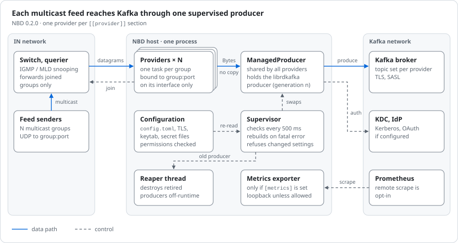

# Nothing But Data

<div align="center">
    
    <h3 align="center">Nothing But Data</h3>
    <p align="center">The No-Bullshit Daemon.</p>
    <div>
        <a href="https://github.com/PetitPrinc3/nbd/actions/workflows/build.yml/"></a>
        <a href="https://github.com/PetitPrinc3/nbd/actions/workflows/audit.yml/"></a>
        <br>
        
    </div>
</div>

---

Nothing But Data (NBD) is a daemon that relays UDP multicast traffic to an Apache Kafka broker. It is written in Rust with `unsafe` code forbidden, and it can run without root privileges or Linux capabilities.

NBD doesn't authenticate the multicast feed: it relays what it receives and assumes a trusted network segment. See [SECURITY.md](SECURITY.md) for the threat model and the self-assessed [ANSSI Secure Rust Guide](https://anssi-fr.github.io/rust-guide/) compliance matrix.

> [!IMPORTANT]
> While this project was written by a human and not vibe-coded, its documentation was generated by Claude Opus 4.6 (Thinking), Sonnet 5, Sonnet 5.5 and Opus 5.5.

> [!WARNING]
> `0.2.0-beta` refuses configuration files written for `0.1.x`. See the [migration notes](CHANGELOG.md#migrating-from-01x).

## How it works

Each `[[provider]]` of the configuration maps one multicast group and port to one Kafka topic.



A provider is a Tokio task that owns one UDP socket. It reads datagrams into a preallocated buffer and submits them to Kafka without blocking. When the producer queue is full, the datagram is dropped and counted.

All providers share one Kafka producer. A supervisor replaces it when `librdkafka` reports a fatal error. If it can't be rebuilt within `recovery_timeout`, NBD exits with an error. See [Producer recovery](PRODUCTION.md#producer-recovery).

At startup, NBD validates the configuration, creates the sockets, checks that the broker answers, and only then joins the multicast groups.

## Getting started

### Requirements

- Rust, pinned by `rust-toolchain.toml`
- A C/C++ toolchain and CMake, to build `librdkafka`
- A Kafka broker

The optional features need system libraries, see [CONTRIBUTING.md](CONTRIBUTING.md#setup).

### Build

```bash
cargo build --locked --release --features kafka-tls,metrics-exporter
```

| Feature | Adds |
|---|---|
| `kafka-tls` | TLS to the broker, and the SASL SCRAM mechanisms |
| `kafka-auth-gssapi` | SASL Kerberos. Doesn't enable TLS: combine it with `kafka-tls` |
| `kafka-auth-oauth` | SASL OAuth 2.0/OIDC. Enables `kafka-tls` |
| `metrics-exporter` | Prometheus endpoint |

Without `kafka-tls`, NBD can only talk to Kafka in plaintext.

### Released binaries

[GitHub Releases](https://github.com/PetitPrinc3/nbd/releases) provides Linux and Windows binaries, with and without the metrics exporter. They have no TLS support and only SASL `PLAIN`: build from source for anything that crosses an untrusted link.

```bash
sha256sum --check --ignore-missing SHA256SUMS
gh attestation verify nbd-<tag>-linux-x86_64 --repo PetitPrinc3/nbd
```

### Run

A minimal `config.toml`, which talks to Kafka in plaintext:

```toml
[kafka]
broker = "192.168.1.100:9092"

[[provider]]
topic = "market-data-feed"
group = "239.255.0.1"
port = 20001
interface = "eth0"
```

The file and its directory must not be writable by group or others.

```bash
nbd --check-config-file config.toml   # validate without starting
nbd --config-file config.toml
```

| Option | Description |
|---|---|
| `--config-file <PATH>` | Configuration file. Without it, NBD logs an error and uses `./config.toml` |
| `--check-config-file <PATH>` | Validate a configuration file and exit |
| `--about` | Show version, features, build date and architecture |
| `-V`, `--version` | Show version and features |
| `-h`, `--help` | Show usage |

`--config-file`, `--check-config-file` and `--about` are mutually exclusive. The exit status is `0` on success, `1` on error, and `2` on invalid arguments.

## Documentation

| Document | Content |
|---|---|
| [CONFIGURATION.md](CONFIGURATION.md) | Parameters, validation rules, secret sources, file permissions |
| [PRODUCTION.md](PRODUCTION.md) | Host setup, network, tuning trade-offs, secrets, recovery, monitoring |
| [SECURITY.md](SECURITY.md) | Vulnerability reporting, threat model, limitations, ANSSI compliance matrix |
| [PERFORMANCE.md](PERFORMANCE.md) | Hot path, benchmarks and results |
| [CONTRIBUTING.md](CONTRIBUTING.md) | Development setup, tests, CI, pull requests |
| [CHANGELOG.md](CHANGELOG.md) | Release history |

## Platforms

Linux x86_64 is the reference platform. Windows x86_64 is supported, with these differences:

- `interface` is an interface index, not a name
- sockets are bound to the wildcard address, without per-group or per-interface isolation
- file permission checks only log a warning
- a graceful shutdown is triggered by Ctrl+C only

## License

[GPL-3.0-or-later](LICENSE).

---

<div align="center">
    <sub>Built with 🦀 by <a href="https://github.com/PetitPrinc3">PetitPrinc3</a></sub>
</div>
